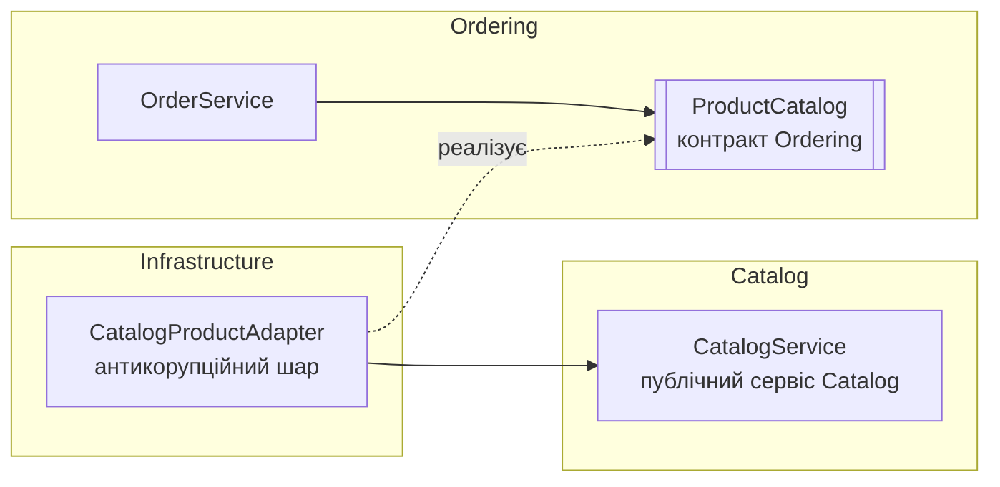
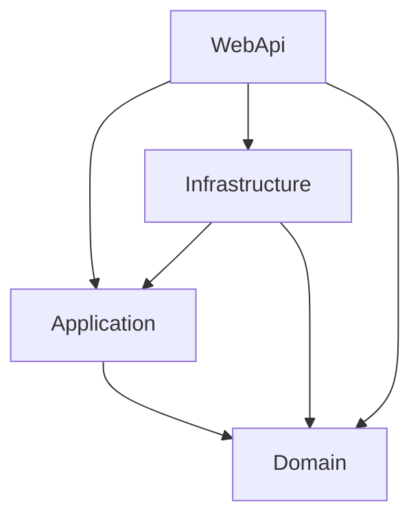

# InternetShop: Clean Architecture та Domain-Driven Design

Практична робота №1 з дисципліни «Архітектура програмного забезпечення».
Тема: **Чиста архітектура та Domain-Driven Design**.

Вебзастосунок інтернет-магазину на **чистій Java 21** (без фреймворків і сторонніх бібліотек), багатомодульний проєкт **Maven** для IntelliJ IDEA.
Застосунок поділено на шари Domain / Application / Infrastructure / WebApi і два bounded context: **Catalog** і **Ordering**.
Це основа, яку розширюватимуть наступні практичні та лабораторні роботи.

## Мета

Сформувати практичні навички проєктування архітектури з використанням принципів чистої архітектури та DDD:
поділ на шари з чітким напрямом залежностей, моделювання предметної області (сутності, об'єкти-значення, агрегати),
визначення bounded context і опис їхньої взаємодії через контракти.

## Завдання та як воно виконане

| Вимога методички | Реалізація |
|---|---|
| Вибрати предметну область | Інтернет-магазин (InternetShop): каталог товарів і замовлення покупців |
| Проєкт з поділом на шари чистої архітектури | 4 модулі Maven: `internetshop-domain`, `-application`, `-infrastructure`, `-webapi` (аналог 4 проєктів рішення ASP.NET Core) |
| Доменна модель з підходами DDD | Сутності, Value Objects, агрегати з інваріантами — див. [Доменна модель](#доменна-модель) |
| Один або декілька bounded context і їх взаємодія | Catalog і Ordering; Ordering звертається до Catalog лише через контракт `ProductCatalog` |
| Domain без залежностей від фреймворків | `internetshop-domain/pom.xml` не має жодних залежностей — лише JDK; додатково перевіряє `Checks` |
| Взаємодія шарів через абстракції | Сховища описані інтерфейсами в Application (`ProductStore`, `OrderStore`, `ProductCatalog`) |
| Немає бізнес-логіки в контролерах і сховищах | Ендпоінти лише викликають сервіси Application; правила — тільки в Domain |

## Предметна область і bounded contexts

**Bounded Context** — межа, всередині якої модель і терміни мають одне чітке значення. Це не технічний шар:
кожен контекст має свою частину в Domain і Application.

| Контекст | Відповідальність | Мова контексту |
|---|---|---|
| **Catalog** | Асортимент: товари, їх назви, описи й поточні ціни | Товар (`Product`) — позиція вітрини |
| **Ordering** | Формування та оформлення замовлень покупців | Рядок замовлення (`OrderLine`) — «знімок» товару: назва й ціна на момент додавання |
| Customer Management | *Не реалізований.* Профілі покупців належали б окремому контексту | В Ordering використовується лише `CustomerId` без перевірки існування покупця |

Слово «товар» в обох контекстах означає різне (як `Customer` у Billing і Marketing у методичці):
у Catalog ціну товару можна змінити, а в Ordering ціна в уже доданому рядку залишається такою, якою була в момент додавання.
Тому Ordering не використовує клас `Product`, а має власну модель `OrderLine`.

### Взаємодія контекстів



1. `OrderService` (Ordering) потребує назву й ціну товару і звертається до інтерфейсу `ProductCatalog`, описаного **мовою Ordering** (`CatalogProduct`).
2. `CatalogProductAdapter` (Infrastructure) реалізує цей інтерфейс: викликає `CatalogService.get` і перекладає `ProductDto` у `CatalogProduct`.
3. Класи Ordering не імпортують жодного класу Catalog, і навпаки (перевіряється в `Checks`). Якщо Catalog стане окремим сервісом, зміниться лише адаптер.

`Money` — спільне ядро (Shared Kernel): однаково розуміється в обох контекстах і лежить у `domain.shared`.

## Доменна модель

| Тип | Контекст | DDD-роль | Призначення |
|---|---|---|---|
| `Product` | Catalog | Сутність, корінь агрегату | Товар каталогу; перевіряє ціну > 0 і довжину опису |
| `ProductName` | Catalog | Value Object | Назва 1–120 символів після обрізання пробілів |
| `Order` | Ordering | Сутність, **корінь агрегату** | Керує рядками й статусом, захищає інваріанти |
| `OrderLine` | Ordering | Сутність усередині агрегату | Товар у замовленні; змінюється лише через `Order` |
| `Quantity` | Ordering | Value Object | Кількість 1–99 |
| `CustomerId` | Ordering | Value Object | Непорожній ідентифікатор покупця |
| `OrderStatus` | Ordering | Перелік | `DRAFT` (чернетка) → `PLACED` (оформлене) |
| `Money` | Shared Kernel | Value Object | Сума ≥ 0, до 2 знаків після коми, не більше 1 000 000 000; `10 == 10.00` |
| `Entity` | Shared | Базовий клас | Спільний `Id` і рівність за ідентичністю |
| `DomainRuleException` | Shared | — | Порушення бізнес-правила (HTTP 400) |

Value Objects реалізовані як Java `record`: вони незмінні, рівність визначається значенням, а перевірка виконується в конструкторі,
тому некоректний об'єкт створити неможливо.

### Бізнес-правила (інваріанти)

- **Catalog:** назва товару містить 1–120 символів; опис має не більше 1000 символів; ціна більша за нуль.
  Товар можна видалити з каталогу; видалити відсутній товар не можна (404).
- **Ordering:**
  - покупець обов'язковий;
  - кількість одного товару від 1 до 99, а повторне додавання того самого товару сумує кількість (межа 99 діє для суми);
  - змінювати можна лише чернетку (`DRAFT`);
  - порожнє замовлення оформити не можна, повторно оформити теж не можна;
  - сума замовлення не може перевищувати межу `Money`.
- Відхилена операція не змінює агрегат: перевірки виконуються **до** зміни стану.

Усі зміни рядків проходять через `Order.addItem`. `getLines()` повертає колекцію лише для читання,
`OrderLine.increase` доступний тільки в пакеті `ordering`, тож обійти корінь агрегату неможливо.

## Шари та залежності

| Шар (модуль) | Компоненти | Відповідальність |
|---|---|---|
| **Domain** | `Product`, `ProductName`, `Order`, `OrderLine`, `Quantity`, `CustomerId`, `Money`, `Entity` | Модель і бізнес-правила. Лише JDK |
| **Application** | `CatalogService`, `OrderService`, інтерфейси `ProductStore`, `OrderStore`, `ProductCatalog`, DTO, винятки | Сценарії використання та контракти, потрібні сценаріям |
| **Infrastructure** | `FileProductStore`, `FileOrderStore`, `TextDataFile`, `CatalogProductAdapter` | Збереження у файли; адаптер між контекстами |
| **WebApi** | `Main`, `InternetShopApp`, `Router`, `Request`, `Json`, `ProductEndpoints`, `OrderEndpoints`, статична сторінка | HTTP, JSON, складання залежностей, перетворення помилок на HTTP-статуси |
| Checks | `Checks` | Консольні перевірки (аналог `CourseDemo.Checks`) |

Залежності між модулями задані в `pom.xml` кожного модуля (розділ `<dependencies>`); інший напрям не скомпілюється:

```text
Application    -> Domain
Infrastructure -> Application, Domain
WebApi         -> Application, Infrastructure, Domain
Domain         -> без залежностей
```



Інтерфейси сховищ належать **Application**, а реалізації — **Infrastructure** (інверсія залежностей).
Конкретні реалізації обираються лише в точці складання `InternetShopApp.start` (Composition Root, аналог `Program.cs`):

```java
ProductStore productStore = new FileProductStore(dataDirectory);
OrderStore orderStore = new FileOrderStore(dataDirectory);
CatalogService catalog = new CatalogService(productStore);
ProductCatalog productCatalog = new CatalogProductAdapter(catalog); // Ordering -> Catalog
OrderService orders = new OrderService(orderStore, productCatalog);
```

DI-контейнера немає: залежності передаються через конструктори вручну.

### Як проходить додавання товару до замовлення

`OrderService.addItem`:

```java
Order order = load(orderId);                                   // 1. завантажити агрегат через OrderStore
CatalogProduct product = catalog.findProduct(productId)...;    // 2. дані з Catalog через контракт
order.addItem(product.id(), product.name(),                    // 3. бізнес-рішення приймає Domain
        new Money(product.price()), new Quantity(quantity));
store.update(order);                                           // 4. зберегти (з перевіркою версії)
return toDto(order);                                           // 5. DTO для відповіді
```

Сервіс **організовує кроки**, `Order` **перевіряє правила**, сховище **зберігає**. Якщо `addItem` відхиляє дію, `update` не виконується.

### Видалення товару і межа між контекстами

`DELETE /products/{id}` → `ProductEndpoints` → `CatalogService.delete` → `ProductStore.remove` → `FileProductStore`.

- **Уже створені замовлення не змінюються.** `OrderLine` зберігає власний «знімок» назви й ціни, тож Ordering не залежить від того, чи існує товар у каталозі.
- **Нові замовлення.** Додати видалений товар не можна: `ProductCatalog` повертає «не знайдено», і API відповідає 404.
- **Чому без зовнішнього ключа.** Між рядками замовлень і товарами каталогу немає зовнішнього ключа: кожен контекст володіє своїми даними.

## Збереження даних

Застосунок написаний на чистій Java, а драйвер БД (SQLite з CourseDemo) був би сторонньою бібліотекою. Тому Infrastructure зберігає дані
у текстових файлах `data/products.db` і `data/orders.db`. Деталі збереження приховані за інтерфейсами `ProductStore` / `OrderStore`,
тож заміна на справжню БД зачепить лише Infrastructure.

- **Модель збереження окрема від доменної:** сховища зберігають записи (`ProductRecord`, `OrderRecord`) і відновлюють доменні об'єкти через
  `Product.restore` / `Order.restore`. Під час відновлення конструктори Value Objects знову перевіряють правила.
- **Агрегат зберігається цілком:** замовлення та всі його рядки.
- **Атомарний запис:** спочатку тимчасовий файл, потім заміна, тому напівзаписаний файл не залишиться.
- **Оптимістичне блокування:** `Order` має `version`. `update` приймається, лише якщо збережена версія збігається з прочитаною,
  інакше виникає `ConcurrentChangeException` → HTTP 409 (аналог `Version` + `IsConcurrencyToken` у CourseDemo).
- Дані зберігаються після перезапуску застосунку.

## HTTP API

| Метод та адреса | Призначення | Тіло JSON |
|---|---|---|
| `GET /` | Демонстраційна сторінка | — |
| `GET /products` | Список товарів | — |
| `GET /products/{id}` | Один товар | — |
| `POST /products` | Створити товар | `{"name":"Миша","description":"","price":649.50}` |
| `DELETE /products/{id}` | Видалити товар з каталогу (відповідь 204 без тіла) | — |
| `GET /orders` | Список замовлень | — |
| `GET /orders/{id}` | Одне замовлення | — |
| `POST /orders` | Створити чернетку | `{"customerId":"11111111-1111-1111-1111-111111111111"}` |
| `POST /orders/{id}/items` | Додати товар | `{"productId":"<id товару>","quantity":2}` |
| `POST /orders/{id}/place` | Оформити замовлення | `{}` |

Для POST потрібен заголовок `Content-Type: application/json`.

| Ситуація | Статус | Звідки |
|---|---|---|
| Порушено бізнес-правило | 400 | `DomainRuleException` |
| Некоректний JSON, Id або тип поля | 400 | `BadRequestException` (WebApi) |
| Товар / замовлення не знайдено | 404 | `NotFoundException` (Application) |
| Неправильний метод | 405 | `Router` |
| Одночасна зміна | 409 | `ConcurrentChangeException` |
| Тіло більше 16 КБ | 413 | `Request` |
| POST без JSON | 415 | `Router` |
| Непередбачена помилка | 500 | загальне повідомлення; подробиці лише в лозі сервера |

Відповідь з помилкою має вигляд `{"error":"текст"}`.

## Безпека даних

- Сервер слухає лише `localhost` (loopback), тому з інших комп'ютерів мережі він недоступний.
- Клієнт не отримує стек викликів і внутрішніх подробиць: для непередбачених помилок повертається загальне повідомлення.
- POST приймається тільки з `Content-Type: application/json`, а це базовий захист від CSRF-запитів зі сторонніх сайтів.
- Тіло запиту обмежене 16 КБ, глибина вкладеності JSON — 20 рівнями, суми — межею `Money`.
- Символи `< > &` у JSON екрануються; сторінка виводить дані лише через `textContent` і має заголовок `Content-Security-Policy`.
- Робочі дані (`data/`) і результати збірки (`target/`) виключені з Git.

## Запуск

Потрібен **JDK 21** або новіший і **Maven 3.9+** (у IntelliJ IDEA Maven вбудований).
Сторонніх бібліотек немає; під час першої збірки Maven один раз завантажує зі свого репозиторію лише плагіни збірки, тож потрібен інтернет.

### IntelliJ IDEA

1. **File → Open** → вибрати папку `InternetShop` (або файл `pom.xml`) → **Open as Project**. IntelliJ імпортує 5 модулів Maven.
2. Якщо IDE повідомить, що JDK не задано: **File → Project Structure → Project → SDK** → JDK 21.
3. Вибрати конфігурацію запуску **InternetShop (localhost:8080)** (зберігається в `.run/`) і натиснути **Run**.
4. Відкрити <http://localhost:8080>.
5. Перевірки: вікно **Maven → InternetShop → Lifecycle → verify** (повна збірка + перевірки)
   або конфігурація **Checks**. Очікуваний результат: `All 51 checks passed.`

### Командний рядок (Maven)

```powershell
mvn verify                                         # збірка всіх модулів + 51 перевірка
mvn package                                        # збірка; виконуваний jar: internetshop-webapi/target/internetshop.jar
java -jar internetshop-webapi/target/internetshop.jar   # запуск на http://localhost:8080 (дані в ./data)
```

Те саме скриптами PowerShell:

```powershell
./run.ps1                  # mvn package + запуск на http://localhost:8080
./check.ps1                # mvn verify
./demo.ps1 -StepByStep     # у другому терміналі, коли застосунок запущено
```

Якщо PowerShell блокує скрипти: `powershell -ExecutionPolicy Bypass -File .\run.ps1`.

`demo.ps1` створює замовлення й по кроках показує: відмову оформити порожнє замовлення, додавання товару з даними з Catalog,
перевищення кількості 99, неіснуючий товар (404), оформлення, заборону змінювати оформлене замовлення та видалення товару з каталогу (204, потім 404).

### Перевірки

`Checks` — консольна програма (як `CourseDemo.Checks`) в окремому модулі `internetshop-checks`. Maven запускає її на фазі `verify`
(через `exec-maven-plugin`); якщо хоч одна перевірка не пройде, збірка завершиться помилкою. Використовується окрема тимчасова папка даних:

- **Domain:** правила Catalog і Ordering, рівність Value Objects, незмінність агрегату після відмови.
- **Application + Infrastructure:** збереження після «перезапуску» (нові екземпляри сховищ), правила після відновлення,
  відсутні об'єкти, взаємодія Ordering → Catalog через контракт, відмова при одночасній зміні;
  видалення товару: зникає з каталогу (і після перезапуску), не змінює наявні замовлення, не додається до нових.
- **Архітектура:** Domain імпортує лише JDK; Application не залежить від Infrastructure, WebApi, HTTP і файлової системи;
  Catalog і Ordering не імпортують класів один одного.
- **HTTP:** запуск сервера на вільному порту та перевірка статусів 200/201/204/400/404/405/413/415.

## Структура проєкту

```text
InternetShop/
├── pom.xml                                      батьківський pom: перелік модулів, Java 21, версії плагінів
├── internetshop-domain/            pom.xml (без залежностей)
│   └── src/main/java/com/internetshop/domain/
│       ├── shared/        Entity, Money, DomainRuleException
│       ├── catalog/       Product, ProductName
│       └── ordering/      Order, OrderLine, Quantity, CustomerId, OrderStatus
├── internetshop-application/       pom.xml (-> domain)
│   └── src/main/java/com/internetshop/application/
│       ├── shared/        NotFoundException, ConcurrentChangeException
│       ├── catalog/       CatalogService, ProductStore, ProductDto, ProductNotFoundException
│       └── ordering/      OrderService, OrderStore, ProductCatalog, CatalogProduct, OrderDto, OrderLineDto, ...
├── internetshop-infrastructure/    pom.xml (-> application, domain)
│   └── src/main/java/com/internetshop/infrastructure/
│       ├── persistence/   FileProductStore, FileOrderStore, TextDataFile
│       └── integration/   CatalogProductAdapter
├── internetshop-webapi/            pom.xml (-> application, infrastructure, domain; збирає internetshop.jar)
│   ├── src/main/java/com/internetshop/webapi/   Main, InternetShopApp, http/, endpoints/
│   └── src/main/resources/static/               index.html, app.js, styles.css
├── internetshop-checks/            pom.xml (-> усі модулі; запуск на mvn verify)
│   └── src/main/java/com/internetshop/checks/Checks.java
├── .run/                           конфігурації запуску IntelliJ (InternetShop, Checks)
├── docs/DEFENSE_NOTES.md           нотатки для підготовки до захисту
└── run.ps1, check.ps1, demo.ps1
```

## Адаптація прикладу CourseDemo (C#) до Java

| CourseDemo (ASP.NET Core) | InternetShop (Java) |
|---|---|
| Рішення `.slnx` + `Directory.Build.props` | Батьківський `pom.xml` (модулі, спільні властивості) |
| Проєкти `.csproj` і `ProjectReference` | Модулі Maven: `pom.xml` з `<dependency>` на інші модулі |
| NuGet-пакети (EF Core, SQLite) | Немає: жодних сторонніх залежностей |
| `record CourseTitle` | `record ProductName` / `Money` / `Quantity` / `CustomerId` |
| `Course` + `Enrollment` (агрегат) | `Order` + `OrderLine` (агрегат) |
| `ICourseStore` в Application | `ProductStore`, `OrderStore`, `ProductCatalog` в Application |
| EF Core + SQLite | Файлове сховище на JDK (`java.nio.file`) |
| `Version` як concurrency token | `version` в `Order` і перевірка в `FileOrderStore.update` |
| `Program.cs`: DI, маршрути, middleware помилок | `InternetShopApp` (складання), `Router` (маршрути та помилки), `*Endpoints` |
| Minimal API (Kestrel) | `com.sun.net.httpserver.HttpServer` з JDK |
| `CourseDemo.Checks` (`dotnet run`) | `internetshop-checks` (`Checks`, запускається в `mvn verify`) |
| Один контекст + `StudentId` | Два контексти (Catalog, Ordering) + `CustomerId` |

## Результат

Застосунок збирається Maven (`mvn verify`), запускається локально і доступний на <http://localhost:8080>. Сторінка показує каталог і замовлення
та дозволяє пройти сценарії: успішні дії й відмови за бізнес-правилами. Усі 51 перевірка проходить.
Структура з шарами та bounded contexts готова до поступового розширення в наступних роботах.
