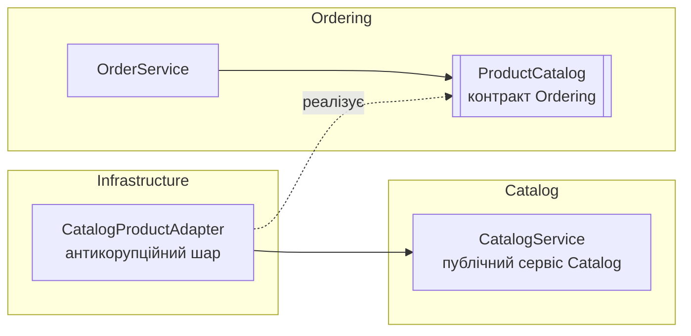
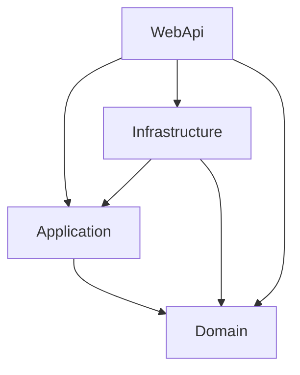
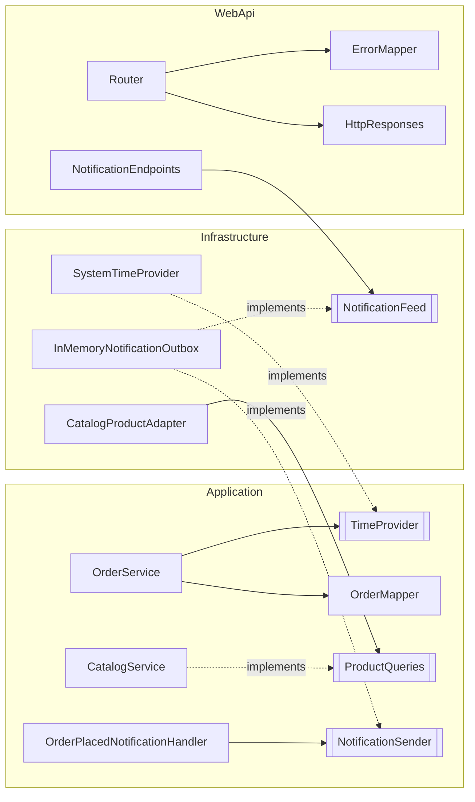
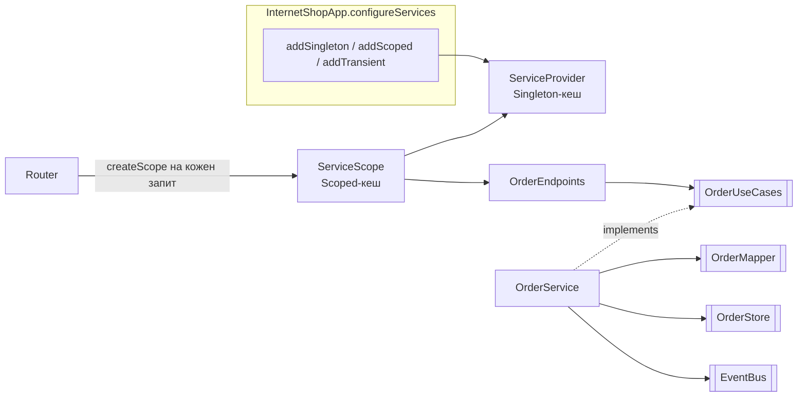
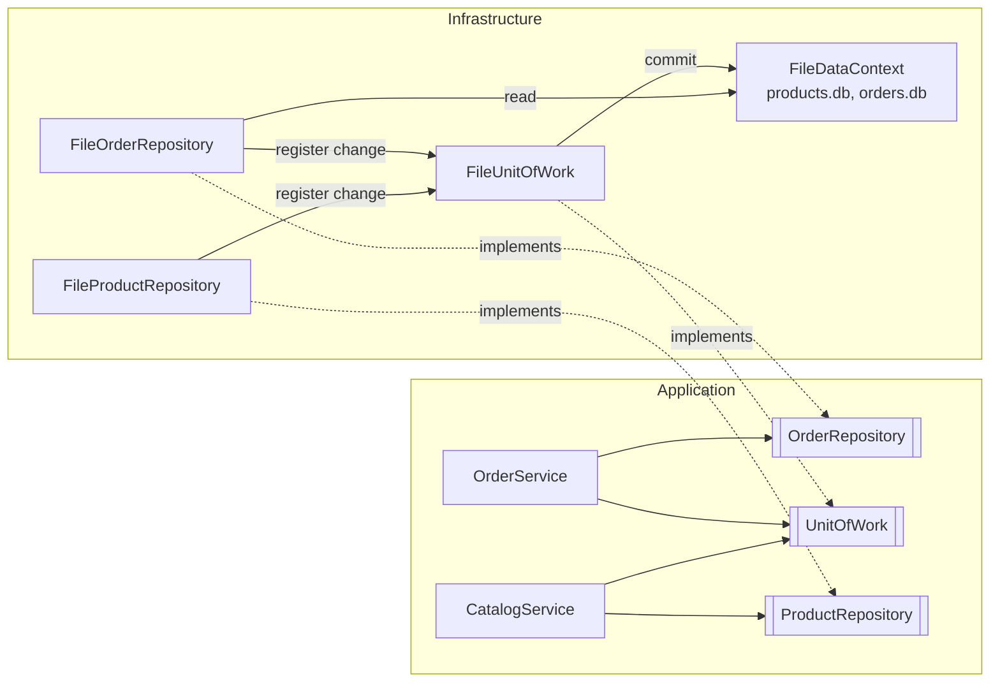
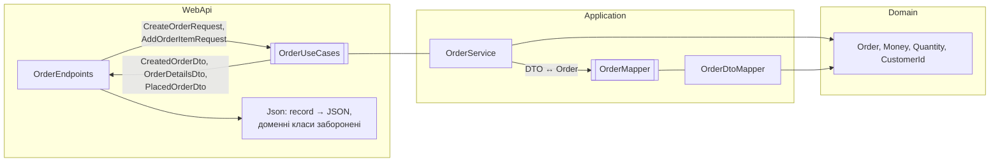

# InternetShop: Clean Architecture, DDD, Event-Driven Design, SOLID, Dependency Injection, Repository та Unit of Work, DTO, архітектурні стилі, валідація

Практичні роботи з дисципліни «Архітектура програмного забезпечення»:
- №1 — **Чиста архітектура та Domain-Driven Design**;
- №2 — **Event-Driven Design** (події та обробники, див. [розділ ПР2](#практична-робота-2-event-driven-design));
- №3 — **Принципи SOLID** (аналіз порушень і рефакторинг, див. [розділ ПР3](#практична-робота-3-принципи-solid));
- №4 — **Dependency Injection та інверсія керування** (DI-контейнер і життєві цикли, див. [розділ ПР4](#практична-робота-4-dependency-injection-та-інверсія-керування));
- №5 — **Repository та Unit of Work** (див. [розділ ПР5](#практична-робота-5-repository-та-unit-of-work));
- №6 — **Об'єкти передавання даних (DTO) та мапінг між шарами** (див. [розділ ПР6](#практична-робота-6-обєкти-передавання-даних-dto-та-мапінг-між-шарами));
- №7 — **Архітектурні стилі та компроміси в розподілених системах** (аналіз стилю, порівняння з мікросервісами, див. [розділ ПР7](#практична-робота-7-архітектурні-стилі-та-компроміси-в-розподілених-системах));
- №8 — **Валідація даних у прикладному рівні (FluentValidation)** (валідатори DTO, автоматична перевірка до use-case, див. [розділ ПР8](#практична-робота-8-валідація-даних-у-прикладному-рівні-fluentvalidation)).

Вебзастосунок інтернет-магазину на **чистій Java 21** (без фреймворків і сторонніх бібліотек), багатомодульний проєкт **Maven** для IntelliJ IDEA.
Застосунок поділено на шари Domain / Application / Infrastructure / WebApi і два bounded context: **Catalog** і **Ordering**.
Це основа, яку розширюватимуть наступні практичні та лабораторні роботи.

## Мета

Сформувати практичні навички проєктування архітектури з використанням принципів чистої архітектури та DDD:
поділ на шари з чітким напрямом залежностей, моделювання предметної області (сутності, об'єкти-значення, агрегати),
визначення bounded context і опис їхньої взаємодії через контракти.

## Завдання та як воно виконане

| Вимога методички | Реалізація |
|---|---|
| Вибрати предметну область | Інтернет-магазин (InternetShop): каталог товарів і замовлення покупців |
| Проєкт з поділом на шари чистої архітектури | 4 модулі Maven: `internetshop-domain`, `-application`, `-infrastructure`, `-webapi` (аналог 4 проєктів рішення ASP.NET Core) |
| Доменна модель з підходами DDD | Сутності, Value Objects, агрегати з інваріантами — див. [Доменна модель](#доменна-модель) |
| Один або декілька bounded context і їх взаємодія | Catalog і Ordering; Ordering звертається до Catalog лише через контракт `ProductCatalog` |
| Domain без залежностей від фреймворків | `internetshop-domain/pom.xml` не має жодних залежностей — лише JDK; додатково перевіряє `Checks` |
| Взаємодія шарів через абстракції | Репозиторії, Unit of Work і контракт між контекстами описані інтерфейсами в Application (`ProductRepository`, `OrderRepository`, `UnitOfWork`, `ProductCatalog`) |
| Немає бізнес-логіки в контролерах і сховищах | Ендпоінти лише викликають сервіси Application; правила — у Domain (з ПР8 перевірки вхідних даних — у валідаторах Application) |

## Предметна область і bounded contexts

**Bounded Context** — межа, всередині якої модель і терміни мають одне чітке значення. Це не технічний шар:
кожен контекст має свою частину в Domain і Application.

| Контекст | Відповідальність | Мова контексту |
|---|---|---|
| **Catalog** | Асортимент: товари, їх назви, описи й поточні ціни | Товар (`Product`) — позиція вітрини |
| **Ordering** | Формування та оформлення замовлень покупців | Рядок замовлення (`OrderLine`) — «знімок» товару: назва й ціна на момент додавання |
| Customer Management | *Не реалізований.* Профілі покупців належали б окремому контексту | В Ordering використовується лише `CustomerId` без перевірки існування покупця |

Слово «товар» в обох контекстах означає різне (як `Customer` у Billing і Marketing у методичці):
у Catalog ціну товару можна змінити, а в Ordering ціна в уже доданому рядку залишається такою, якою була в момент додавання.
Тому Ordering не використовує клас `Product`, а має власну модель `OrderLine`.

### Взаємодія контекстів



1. `OrderService` (Ordering) потребує назву й ціну товару і звертається до інтерфейсу `ProductCatalog`, описаного **мовою Ordering** (`CatalogProduct`).
2. `CatalogProductAdapter` (Infrastructure) реалізує цей інтерфейс: викликає `CatalogService.get` і перекладає `ProductDto` у `CatalogProduct`.
3. Класи Ordering не імпортують жодного класу Catalog, і навпаки (перевіряється в `Checks`). Якщо Catalog стане окремим сервісом, зміниться лише адаптер.

`Money` — спільне ядро (Shared Kernel): однаково розуміється в обох контекстах і лежить у `domain.shared`.

## Доменна модель

| Тип | Контекст | DDD-роль | Призначення |
|---|---|---|---|
| `Product` | Catalog | Сутність, корінь агрегату | Товар каталогу; перевіряє ціну > 0 і довжину опису |
| `ProductName` | Catalog | Value Object | Назва 1–120 символів після обрізання пробілів |
| `Order` | Ordering | Сутність, **корінь агрегату** | Керує рядками й статусом, захищає інваріанти |
| `OrderLine` | Ordering | Сутність усередині агрегату | Товар у замовленні; змінюється лише через `Order` |
| `Quantity` | Ordering | Value Object | Кількість 1–99 |
| `CustomerId` | Ordering | Value Object | Непорожній ідентифікатор покупця |
| `OrderStatus` | Ordering | Перелік | `DRAFT` (чернетка) → `PLACED` (оформлене) |
| `Money` | Shared Kernel | Value Object | Сума ≥ 0, до 2 знаків після коми, не більше 1 000 000 000; `10 == 10.00` |
| `Entity` | Shared | Базовий клас | Спільний `Id` і рівність за ідентичністю |
| `DomainRuleException` | Shared | — | Порушення бізнес-правила (HTTP 400) |

Value Objects реалізовані як Java `record`: вони незмінні, рівність визначається значенням, а перевірка виконується в конструкторі,
тому некоректний об'єкт створити неможливо.

### Бізнес-правила (інваріанти)

- **Catalog:** назва товару містить 1–120 символів; опис має не більше 1000 символів; ціна більша за нуль.
  Товар можна видалити з каталогу; видалити відсутній товар не можна (404).
- **Ordering:**
  - покупець обов'язковий;
  - кількість одного товару від 1 до 99, а повторне додавання того самого товару сумує кількість (межа 99 діє для суми);
  - змінювати можна лише чернетку (`DRAFT`);
  - порожнє замовлення оформити не можна, повторно оформити теж не можна;
  - сума замовлення не може перевищувати межу `Money`.
- Відхилена операція не змінює агрегат: перевірки виконуються **до** зміни стану.

Усі зміни рядків проходять через `Order.addItem`. `getLines()` повертає колекцію лише для читання,
`OrderLine.increase` доступний тільки в пакеті `ordering`, тож обійти корінь агрегату неможливо.

## Шари та залежності

| Шар (модуль) | Компоненти | Відповідальність |
|---|---|---|
| **Domain** | `Product`, `ProductName`, `Order`, `OrderLine`, `Quantity`, `CustomerId`, `Money`, `Entity` | Модель і бізнес-правила. Лише JDK |
| **Application** | `CatalogService`, `OrderService`, мапери DTO, інтерфейси `CatalogUseCases`, `OrderUseCases`, `ProductRepository`, `OrderRepository`, `UnitOfWork`, `ProductCatalog`, `ProductQueries`, `TimeProvider`, DTO, винятки | Сценарії використання та контракти, потрібні сценаріям |
| **Infrastructure** | `FileDataContext`, `FileUnitOfWork`, `FileProductRepository`, `FileOrderRepository`, `TextDataFile`, `CatalogProductAdapter`, `SystemTimeProvider` | Збереження у файли; адаптер між контекстами; системний час |
| **WebApi** | `Main`, `InternetShopApp`, DI-контейнер `di/`, `Router`, `ErrorMapper`, `HttpResponses`, `Request`, `Json`, `*Endpoints`, статична сторінка | HTTP, JSON, складання залежностей (контейнер), перетворення помилок на HTTP-статуси |
| Checks | `Checks` | Консольні перевірки (аналог `CourseDemo.Checks`) |

Залежності між модулями задані в `pom.xml` кожного модуля (розділ `<dependencies>`); інший напрям не скомпілюється:

```text
Application    -> Domain
Infrastructure -> Application, Domain
WebApi         -> Application, Infrastructure, Domain
Domain         -> без залежностей
```



Інтерфейси репозиторіїв і Unit of Work належать **Application**, а реалізації — **Infrastructure** (інверсія залежностей).
Конкретні реалізації обираються лише в точці складання `InternetShopApp.configureServices` (Composition Root, аналог `Program.cs`).
З ПР4 там лише реєструються пари «абстракція → реалізація» з життєвим циклом, а об'єкти створює DI-контейнер:

```java
services.addSingleton(FileDataContext.class, s -> new FileDataContext(dataDirectory));
services.addScoped(OrderRepository.class, FileOrderRepository.class);  // ПР5
services.addScoped(UnitOfWork.class, s -> s.get(FileUnitOfWork.class)); // ПР5
services.addScoped(CatalogUseCases.class, CatalogService.class);
services.addScoped(ProductCatalog.class, CatalogProductAdapter.class); // Ordering -> Catalog
services.addScoped(OrderUseCases.class, OrderService.class);           // ПР2 + ПР3 + ПР4
services.addTransient(OrderMapper.class, OrderDtoMapper.class);
```

### Як проходить додавання товару до замовлення

`OrderService.addItem`:

```java
Order order = load(orderId);                                   // 1. завантажити агрегат через OrderRepository
CatalogProduct product = catalog.findProduct(productId)...;    // 2. дані з Catalog через контракт
order.addItem(product.id(), product.name(),                    // 3. бізнес-рішення приймає Domain
        new Money(product.price()), new Quantity(quantity));
orders.update(order);                                          // 4. позначити зміну в репозиторії
unitOfWork.saveChanges();                                      // 5. зберегти (атомарно, з перевіркою версії)
return mapper.toDto(order);                                    // 6. DTO для відповіді
```

Сервіс **організовує кроки**, `Order` **перевіряє правила**, репозиторій і Unit of Work **зберігають**. Якщо `addItem` відхиляє дію, до `saveChanges` справа не доходить.

### Видалення товару і межа між контекстами

`DELETE /products/{id}` → `ProductEndpoints` → `CatalogService.delete` → `ProductRepository.remove` + `UnitOfWork.saveChanges` → `FileDataContext`.

- **Уже створені замовлення не змінюються.** `OrderLine` зберігає власний «знімок» назви й ціни, тож Ordering не залежить від того, чи існує товар у каталозі.
- **Нові замовлення.** Додати видалений товар не можна: `ProductCatalog` повертає «не знайдено», і API відповідає 404.
- **Чому без зовнішнього ключа.** Між рядками замовлень і товарами каталогу немає зовнішнього ключа: кожен контекст володіє своїми даними.

## Збереження даних

Застосунок написаний на чистій Java, а драйвер БД (SQLite з CourseDemo) був би сторонньою бібліотекою. Тому Infrastructure зберігає дані
у текстових файлах `data/products.db` і `data/orders.db`. Деталі збереження приховані за інтерфейсами `ProductRepository` / `OrderRepository` / `UnitOfWork`,
тож заміна на справжню БД зачепить лише Infrastructure.

- **Модель збереження окрема від доменної:** `FileDataContext` зберігає записи (`ProductRecord`, `OrderRecord`), а репозиторії відновлюють доменні об'єкти через
  `Product.restore` / `Order.restore`. Під час відновлення конструктори Value Objects знову перевіряють правила.
- **Агрегат зберігається цілком:** замовлення та всі його рядки.
- **Атомарний запис:** спочатку тимчасовий файл, потім заміна, тому напівзаписаний файл не залишиться.
- **Оптимістичне блокування:** `Order` має `version`. зміна приймається під час `saveChanges`, лише якщо збережена версія збігається з прочитаною,
  інакше виникає `ConcurrentChangeException` → HTTP 409 (аналог `Version` + `IsConcurrencyToken` у CourseDemo).
- Дані зберігаються після перезапуску застосунку.

## HTTP API

| Метод та адреса | Призначення | Тіло JSON |
|---|---|---|
| `GET /` | Демонстраційна сторінка | — |
| `GET /products` | Список товарів | — |
| `GET /products/{id}` | Один товар | — |
| `POST /products` | Створити товар | `{"name":"Миша","description":"","price":649.50}` |
| `DELETE /products/{id}` | Видалити товар з каталогу (відповідь 204 без тіла) | — |
| `GET /orders` | Список замовлень | — |
| `GET /orders/{id}` | Одне замовлення | — |
| `POST /orders` | Створити чернетку | `{"customerId":"11111111-1111-1111-1111-111111111111"}` |
| `POST /orders/{id}/items` | Додати товар | `{"productId":"<id товару>","quantity":2}` |
| `POST /orders/{id}/place` | Оформити замовлення (публікує подію `OrderPlaced`) | `{}` |
| `GET /notifications` | Сповіщення, створені обробником `OrderPlaced` (ПР2) | — |
| `GET /statistics` | Статистика, яку оновлюють обробники подій (ПР2) | — |

Для POST потрібен заголовок `Content-Type: application/json`.

Після ПР6 тіло кожної відповіді — це DTO конкретної операції: `POST /orders` → `CreatedOrderDto` (`id`, `status`),
`GET /orders`, `GET /orders/{id}`, `POST /orders/{id}/items` → `OrderDetailsDto` (`id`, `status`, `lines`, `total`),
`POST /orders/{id}/place` → `PlacedOrderDto` (`id`, `status`, `itemCount`, `total`), `GET /products...` → `ProductDto`,
`POST /products` → `CreatedProductDto` (`id`, `name`).

| Ситуація | Статус | Звідки |
|---|---|---|
| Вхідні дані не пройшли валідацію (ПР8) | 400 | `ValidationException` → `ValidationProblemDetails` (помилки за полями) |
| Порушено бізнес-правило | 400 | `DomainRuleException` |
| Некоректний JSON, Id або тип поля | 400 | `BadRequestException` (WebApi) |
| Товар / замовлення не знайдено | 404 | `NotFoundException` (Application) |
| Неправильний метод | 405 | `Router` |
| Одночасна зміна | 409 | `ConcurrentChangeException` |
| Тіло більше 16 КБ | 413 | `Request` |
| POST без JSON | 415 | `Router` |
| Непередбачена помилка | 500 | загальне повідомлення; подробиці лише в лозі сервера |

Відповідь з помилкою має вигляд `{"error":"текст"}`. Помилка валідації (ПР8) додатково містить `title`, `status`
і `errors` — повідомлення, згруповані за полями запиту: `{"title":"Вхідні дані не пройшли перевірку.","status":400,
"error":"Назва товару обов'язкова.","errors":{"name":["Назва товару обов'язкова."]}}`.

## Безпека даних

- Сервер слухає лише `localhost` (loopback), тому з інших комп'ютерів мережі він недоступний.
- Клієнт не отримує стек викликів і внутрішніх подробиць: для непередбачених помилок повертається загальне повідомлення.
- POST приймається тільки з `Content-Type: application/json`, а це базовий захист від CSRF-запитів зі сторонніх сайтів.
- Тіло запиту обмежене 16 КБ, глибина вкладеності JSON — 20 рівнями, суми — межею `Money`.
- Символи `< > &` у JSON екрануються; сторінка виводить дані лише через `textContent` і має заголовок `Content-Security-Policy`.
- ПР6: назовні передаються лише DTO з потрібними полями. Ідентифікатори покупців і внутрішня версія агрегату у відповідях
  не з'являються (раніше `GET /orders` і `GET /notifications` показували `customerId` усіх покупців). Серіалізатор JSON
  відмовляється записувати доменні об'єкти й невідомі типи, тож випадково «віддати» сутність через `toString()` неможливо.
- ПР8: некоректні вхідні дані відхиляються до виконання сценарію, тож нічого не зберігається. У відповіді з помилками
  валідації лише назви полів і тексти правил — значення, які надіслав клієнт, назад не повертаються.
- Робочі дані (`data/`) і результати збірки (`target/`) виключені з Git.

## Практична робота №2: Event-Driven Design

Після успішної бізнес-операції `OrderService` (ініціатор, producer) публікує **подію** — факт, що вже стався.
Хто на неї реагує, `OrderService` не знає: обробники (consumers) підписуються на події в точці складання `InternetShopApp`.

| Вимога методички | Реалізація |
|---|---|
| Використати проєкт попередньої роботи | Той самий InternetShop; шари, контексти та правила ПР1 не змінені |
| Подія — окремий клас без бізнес-логіки | `OrderCreated`, `OrderPlaced` (Java `record`, лише дані) в `application/ordering/events` |
| Обробники для окремих сценаріїв реакції | `OrderPlacedNotificationHandler` (сповіщення), `OrderCreatedStatisticsHandler`, `OrderPlacedStatisticsHandler` (статистика) |
| Немає прямих залежностей між ініціатором і споживачами | `OrderService` знає лише інтерфейс `EventBus`; підписки — в `InternetShopApp`; перевіряє `Checks` |
| Обробники не викликаються напряму з бізнес-логіки чи контролерів | Їх викликає лише `InProcessEventBus.publish` |
| Перевірити роботу системи | `mvn verify`: 68 перевірок (51 з ПР1 + 17 нових) |

| Компонент | Шар / пакет | Роль |
|---|---|---|
| `Event`, `EventBus`, `EventHandler<E>` | Application, `shared/events` | Контракти: подія, публікація, обробник (аналог `IEventBus`, `IEventHandler<T>`) |
| `OrderCreated`, `OrderPlaced` | Application, `ordering/events` | Події контексту Ordering |
| `OrderService` | Application, `ordering` | Producer: публікує подію **після** збереження агрегату |
| `OrderPlacedNotificationHandler`, `Notification`, `NotificationSender`, `NotificationFeed` (до ПР3 — `NotificationOutbox`) | Application, `notifications` | Consumer: сповіщення покупцю про оформлене замовлення |
| `OrderCreatedStatisticsHandler`, `OrderPlacedStatisticsHandler`, `SalesStatistics` | Application, `analytics` | Consumers: статистика продажів |
| `InProcessEventBus` | Infrastructure, `events` | Шина в межах процесу: зберігає підписки та передає подію обробникам |
| `InMemoryNotificationOutbox` | Infrastructure, `notifications` | Імітація надсилання: останні 50 сповіщень у пам'яті |
| `NotificationEndpoints`, `StatisticsEndpoints` | WebApi | `GET /notifications`, `GET /statistics` (лише читання) |

```text
POST /orders/{id}/place → OrderService.place → Order.place() → OrderRepository.update → UnitOfWork.saveChanges → EventBus.publish(OrderPlaced)
                                                                             ├─► OrderPlacedNotificationHandler → NotificationSender
                                                                             └─► OrderPlacedStatisticsHandler   → SalesStatistics
```

Особливості реалізації:
- Доставка **синхронна, у межах одного процесу** (без черги чи брокера повідомлень): простий варіант, достатній для одного застосунку.
- Подія публікується лише після успішного збереження; відхилена операція подій не створює.
- Помилка обробника записується в лог (без даних події) і не скасовує вже збережене замовлення та не заважає іншим обробникам.
- Сповіщення й статистика зберігаються в пам'яті та обнуляються після перезапуску; замовлення й товари, як і раніше, у файлах.
- Нова реакція на подію = новий клас-обробник + один рядок `subscribe` в `InternetShopApp`, без змін в `OrderService`.

## Практична робота №3: Принципи SOLID

Завдання: знайти в наявному коді порушення принципів SOLID і виправити їх рефакторингом, **не змінюючи поведінку системи**.
Основні принципи — **SRP і DIP** (рекомендовані методичкою), додатково ISP та OCP; LSP перевірено аналізом.
Функціонал, HTTP API і формат даних не змінилися: усі 68 перевірок ПР1–ПР2 проходять з тими самими очікуваннями (змінено лише виклики нових конструкторів), додано 14 нових.

| Вимога методички | Реалізація |
|---|---|
| Проаналізувати компоненти і знайти порушення SOLID | Таблиця нижче: 5 знайдених порушень у Application, Infrastructure і WebApi |
| Обрати мінімум два принципи (рекомендовано SRP + DIP) | SRP і DIP — основні; також ISP і OCP |
| Виконати рефакторинг | Нові класи/інтерфейси: `OrderMapper`, `ProductMapper`, `TimeProvider`, `SystemTimeProvider`, `ProductQueries`, `NotificationSender`, `NotificationFeed`, `ErrorMapper`, `HttpResponses` |
| Зберегти працездатність і функціонал | `mvn verify`: 82 перевірки (68 з ПР1–ПР2 + 14 нових) |
| Обґрунтувати зміни | Колонки «Порушення» і «Виправлення» нижче |

| Принцип | Порушення (до ПР3) | Виправлення |
|---|---|---|
| **SRP** | `OrderService` і `CatalogService` поєднували сценарії та перетворення агрегатів на DTO | Мапінг винесено в `OrderMapper` і `ProductMapper`; сервіси лише організовують сценарії |
| **SRP + OCP** | `Router` одночасно шукав маршрут, знав винятки Domain/Application (ланцюжок `catch`), формував відповіді й заголовки безпеки. Новий тип помилки = зміна `Router` | `Router` лише маршрутизує; правила «виняток → статус» — у `ErrorMapper` (налаштовується в `InternetShopApp`), запис відповідей — у `HttpResponses` |
| **DIP** | `OrderService` напряму викликав системний годинник `Instant.now()` — прихована залежність від конкретної деталі, час подій неможливо підмінити | Абстракція `TimeProvider` в Application, реалізація `SystemTimeProvider` в Infrastructure, передається через конструктор |
| **DIP + ISP** | `CatalogProductAdapter` залежав від конкретного класу `CatalogService` і через нього мав доступ до створення й видалення товарів, хоча потрібен лише пошук | Вузький інтерфейс `ProductQueries` (`list`, `get`), який реалізує `CatalogService`; адаптер залежить лише від нього |
| **ISP** | Один інтерфейс `NotificationOutbox` (`add` + `findRecent`): обробник події залежав від читання, а HTTP-маршрут — від запису | `NotificationSender` (для обробника) і `NotificationFeed` (для `GET /notifications`); `InMemoryNotificationOutbox` реалізує обидва |
| **LSP** (аналіз) | Порушень не знайдено: підтипи не посилюють передумов і не кидають `UnsupportedOperationException` | Показано перевіркою: правило для `NotFoundException` коректно обробляє `ProductNotFoundException` і `OrderNotFoundException` |



Що це дає: класи змінюються з однієї причини (формат DTO, правила HTTP-помилок, запис відповідей — кожне в одному місці);
сценарії й адаптер можна перевірити із заглушками (фіксований час, тестовий каталог) без файлів і системного годинника;
кожен клієнт бачить лише потрібні методи — адаптер не може видалити товар, а HTTP-маршрут не може створити сповіщення.

## Практична робота №4: Dependency Injection та інверсія керування

Завдання: проаналізувати залежності між компонентами, знайти випадки створення залежностей усередині класів,
замінити їх на Dependency Injection, забезпечити залежність від абстракцій і налаштувати DI-контейнер із життєвими циклами.
Оскільки ПР3 вже ввела DIP (`TimeProvider`, `ProductQueries`, `OrderStore` (з ПР5 — `OrderRepository`), `EventBus` через конструктори), ПР4 доповнює це
**контейнером** (інверсія керування: об'єкти створює не код застосунку, а контейнер) і прибирає залишки статичних залежностей.
Функціонал, HTTP API і формат даних не змінилися: 82 перевірки ПР1–ПР3 проходять (змінено лише виклики конструкторів), додано 19 нових.

| Вимога методички | Реалізація |
|---|---|
| 1. Проаналізувати залежності між компонентами | Таблиця нижче |
| 2. Виявити створення залежностей усередині класів | Статичні виклики `OrderMapper.toDto` / `ProductMapper.toDto` у сервісах; статичні `*Endpoints.register(router, service)`; ручне `new` усіх об'єктів у правильному порядку в `InternetShopApp` |
| 3. Замінити пряме створення на DI | Мапери передаються в `OrderService` / `CatalogService` через конструктор; ендпоінти — звичайні класи з ін'єкцією через конструктор; усі об'єкти створює контейнер |
| 4. Залежність від абстракцій | Нові інтерфейси `OrderMapper`, `ProductMapper`, `OrderUseCases`, `CatalogUseCases`, `SalesReport`; ендпоінти й сервіси мають у конструкторах лише інтерфейси |
| 5. Налаштувати контейнер і життєві цикли | Пакет `webapi/di`: `ServiceCollection` (`addSingleton` / `addScoped` / `addTransient`), `ServiceProvider`, `ServiceScope`; область (scope) — один HTTP-запит |
| 6. Перевірити працездатність | `mvn verify`: 101 перевірка (82 з ПР1–ПР3 + 19 нових), ручний запуск — без змін у поведінці |

| Компонент | До ПР4 | Після ПР4 |
|---|---|---|
| `OrderService`, `CatalogService` | Статичні виклики `OrderMapper.toDto(...)`, `ProductMapper.toDto(...)` — жорстка прив'язка до конкретного класу | `OrderMapper` / `ProductMapper` — інтерфейси, реалізації `OrderDtoMapper` / `ProductDtoMapper` приходять через конструктор |
| `ProductEndpoints`, `OrderEndpoints`, ... | Статичний метод `register(router, CatalogService)`: залежність від конкретного класу, один екземпляр на весь час роботи | Клас з конструктором `ProductEndpoints(CatalogUseCases)`; екземпляр на кожен запит створює контейнер (як контролер ASP.NET Core) |
| `StatisticsEndpoints` | Залежав від класу `SalesStatistics` (з методами зміни статистики) | Залежить від інтерфейсу `SalesReport` (лише `snapshot()`) |
| `InternetShopApp` | Вручну створював ~15 об'єктів через `new` у потрібному порядку | Лише реєстрації з життєвим циклом; граф об'єктів будує контейнер |
| `Router` | Викликав готові лямбди | Створює область контейнера на кожен запит і отримує з неї ендпоінт |

**Життєві цикли** (як у методичці: `AddTransient` / `AddScoped` / `AddSingleton`):

| Lifetime | Компоненти | Чому |
|---|---|---|
| **Transient** | `OrderMapper`, `ProductMapper` | Легковагові, без стану — приклад з методички `AddTransient<IOrderMapper, OrderMapper>()` |
| **Scoped** (один HTTP-запит) | `CatalogUseCases`/`ProductQueries` (`CatalogService`), `OrderUseCases` (`OrderService`), `ProductCatalog` (`CatalogProductAdapter`), усі `*Endpoints` | Сценарії одного запиту: усі компоненти запиту отримують той самий екземпляр, різні запити — різні |
| **Singleton** | `EventBus` (`InProcessEventBus`), `ProductStore`, `OrderStore` (з ПР5 — `FileDataContext`, а репозиторії й `UnitOfWork` стали Scoped), `TimeProvider`, `NotificationSender`/`NotificationFeed`, `SalesStatistics`/`SalesReport`, обробники подій, `ErrorMapper`, `Router` | Спільний стан або конфігурація застосунку. Шина — приклад з методички `AddSingleton<IEventBus, InProcessEventBus>()`. Файлові сховища тримають єдину копію даних у пам'яті й синхронізують запис, тому, на відміну від EF-репозиторіїв (Scoped через `DbContext`), вони Singleton |



Правила з методичних вказівок, які забезпечує код:
- **ін'єкція через конструктор** — контейнер створює клас через його єдиний public-конструктор, отримуючи кожен параметр за типом;
- **без статичних залежностей і сервіс-локатора** — мапери й ендпоінти більше не статичні; контейнер (`ServiceResolver`) бачать лише
  `InternetShopApp` і `Router`, а Domain, Application, Infrastructure та ендпоінти його не імпортують (перевіряється в `Checks`; модуль Application
  і не може його імпортувати — він не залежить від WebApi);
- **розмежування життєвих циклів** — Scoped не можна отримати поза областю запиту, а Singleton, якому потрібна Scoped-залежність,
  відхиляється з повідомленням на кшталт `SINGLETON X не може залежати від SCOPED Y` (помилка життєвого циклу з методички);
  також виявляються незареєстровані залежності, цикли й повторні реєстрації;
- **узгодженість із SOLID і Clean Architecture** — контейнер лежить у зовнішньому шарі (WebApi), внутрішні шари знають лише свої інтерфейси.

Свідомо не змінено: `FileProductStore`/`FileOrderStore` (з ПР5 — `FileDataContext`) створюють `TextDataFile` усередині — це приватна деталь формату файлу, а не замінна
служба (замінюється все сховище через `ProductStore`/`OrderStore`); обробники подій залежать від класу `SalesStatistics` у тому ж пакеті Application —
це модель для читання, яку вони оновлюють, без альтернативних реалізацій.

## Практична робота №5: Repository та Unit of Work

Завдання: проаналізувати доступ до даних, виділити інтерфейс репозиторію, реалізувати його в Infrastructure, додати Unit of Work
і змінити прикладний рівень так, щоб він працював лише з цими абстракціями.
Функціонал, HTTP API і формат файлів даних не змінилися: 101 перевірка ПР1–ПР4 проходить (змінено лише створення сервісів у перевірках), додано 11 нових.

| Вимога методички | Реалізація |
|---|---|
| 1. Проаналізувати доступ до даних | До ПР5 `FileOrderStore` / `FileProductStore` одночасно були «колекцією» і самі записували файл у кожному `add` / `update` / `remove`: межу транзакції визначав не сценарій, а сховище, і дві зміни однієї операції записувались окремо |
| 2. Інтерфейс репозиторію | `OrderRepository` (Application/ordering) і `ProductRepository` (Application/catalog): `findAll`, `findById`, `add`, `update` / `remove` — операції над колекцією агрегатів |
| 3. Реалізація в Infrastructure | `FileOrderRepository`, `FileProductRepository`: лише перетворення агрегат ↔ запис і реєстрація змін, без бізнес-правил і без роботи з файлами |
| 4. Абстракція Unit of Work | `UnitOfWork.saveChanges()` (Application/shared); реалізація `FileUnitOfWork` накопичує зміни запиту й передає їх у `FileDataContext.commit` (аналог `AppDbContext.SaveChanges`) |
| 5. Прикладний рівень — лише через абстракції | `OrderService(OrderRepository, UnitOfWork, ...)`, `CatalogService(ProductRepository, UnitOfWork, ProductMapper)`; кожен сценарій завершується одним `unitOfWork.saveChanges()` |
| 6. Перевірити бізнес-операції | `mvn verify`: 112 перевірок (101 з ПР1–ПР4 + 11 нових), відповіді HTTP API до і після змін однакові |



Як працює `saveChanges` (`FileDataContext.commit`):
1. зміни запиту застосовуються до **копії** таблиць; якщо хоч одна не проходить перевірку (застаріла версія → `ConcurrentChangeException`), збережений стан не змінюється;
2. змінені файли записуються, кожен атомарно (тимчасовий файл + заміна); якщо другий файл записати не вдалося, перший повертається до попереднього вмісту;
3. лише після цього копія стає поточним станом. Після `saveChanges` (успішного чи ні) список змін очищується, а незбережені зміни відкидаються при закритті області запиту.

| Компонент | Lifetime | Чому |
|---|---|---|
| `FileDataContext` | Singleton | Єдина копія збережених даних і синхронізований запис у файли |
| `FileUnitOfWork` (`UnitOfWork`), `FileOrderRepository`, `FileProductRepository` | Scoped | Як у методичці (`AddScoped`): усі репозиторії одного HTTP-запиту реєструють зміни в одному Unit of Work |

Методичні вказівки: бізнес-логіки в репозиторіях немає (правила перевіряють `Order` / `Product`); деталі зберігання (файли, `TextDataFile`, записи)
не виходять за межі пакета `infrastructure.persistence`; імена методів — операції над колекцією (`add`, `findById`, `update`, `remove`);
події ПР2 публікуються лише після успішного `saveChanges`, DI ПР4 збирає репозиторії та Unit of Work через конструктори.

## Практична робота №6: Об'єкти передавання даних (DTO) та мапінг між шарами

Завдання: проаналізувати взаємодію прикладного рівня з вебінтерфейсом, виділити DTO для бізнес-операцій, реалізувати мапінг
між доменною моделлю та DTO і змінити ендпоінти так, щоб вони працювали виключно з DTO.
Бізнес-правила, формат файлів даних, адреси HTTP API і вебсторінка не змінилися; 112 перевірок ПР1–ПР5 проходять
(змінено лише виклики сценаріїв — тепер через DTO запитів), додано 20 нових.

| Вимога методички | Реалізація |
|---|---|
| 1. Проаналізувати взаємодію Application ↔ WebApi | До ПР6: один `OrderDto` на всі 5 операцій (створення, список, перегляд, додавання, оформлення), вхідних DTO немає — сценарії приймали розрізнені параметри (`create(UUID)`, `addItem(UUID, UUID, int)`), ендпоінти вручну перекладали DTO у `Map`, а у відповідях були зайві дані (`customerId` у `GET /orders` і `GET /notifications`) |
| 2. Виділити DTO для бізнес-операцій | Пакети `application/ordering/dto` і `application/catalog/dto`: вхідні `CreateOrderRequest`, `AddOrderItemRequest`, `CreateProductRequest`; вихідні `CreatedOrderDto`, `OrderDetailsDto` (+ `OrderLineDto`), `PlacedOrderDto`, `ProductDto`, `CreatedProductDto` |
| 3. Мапінг домен ↔ DTO | Ручний мапінг у прикладному шарі, в окремих компонентах `OrderDtoMapper` / `ProductDtoMapper` (за інтерфейсами `OrderMapper` / `ProductMapper`): DTO → домен (`toNewOrder`, `toNewProduct`) і домен → DTO (`toDetails`, `toCreated`, `toPlaced`, `toDto`) |
| 4. Контролери/API лише з DTO | `OrderEndpoints`, `ProductEndpoints`: JSON запиту → DTO запиту → сценарій → DTO результату, який повертається як є (`Response.ok(dto)`, аналог `return Ok(result)`); `Json` серіалізує DTO-записи за їхніми полями |
| 5. Немає передачі доменних сутностей назовні | Сигнатури `OrderUseCases` / `CatalogUseCases` / `ProductQueries` містять лише DTO та `UUID`; ендпоінти не імпортують Domain; `Json` кидає помилку на доменний об'єкт (→ 500 без деталей) |
| 6. Перевірити коректність | `mvn verify`: 132 перевірки (112 з ПР1–ПР5 + 20 нових), вебсторінка працює без змін |



| Операція | Вхід | Вихід | Що навмисно не передається |
|---|---|---|---|
| `POST /orders` | `CreateOrderRequest(customerId)` | `CreatedOrderDto(id, status)` | рядки, сума (у нового замовлення їх немає) |
| `GET /orders`, `GET /orders/{id}` | Id з адреси | `OrderDetailsDto(id, status, lines, total)` | `customerId`, `version`, внутрішні Id рядків |
| `POST /orders/{id}/items` | `AddOrderItemRequest(productId, quantity)` | `OrderDetailsDto` — клієнт показує оновлений кошик | назву й ціну клієнт не передає: їх бере Ordering з каталогу |
| `POST /orders/{id}/place` | Id з адреси | `PlacedOrderDto(id, status, itemCount, total)` | перелік рядків |
| `POST /products` | `CreateProductRequest(name, description, price)` | `CreatedProductDto(id, name)` | — |
| `GET /products...` | Id з адреси | `ProductDto(id, name, description, price)` | Value Objects `ProductName`, `Money` (лише `String` / `BigDecimal`) |

Методичні вказівки: DTO — незмінні `record` без бізнес-логіки (перевірки виконує Domain під час мапінгу DTO → домен);
кожна операція має власний DTO, а спільний `OrderDetailsDto` використовують лише сценарії «показати кошик»;
мапінг — у прикладному шарі в окремих компонентах, зареєстрованих у DI-контейнері як Transient (ПР4); DTO не залежать від Domain
і узгоджені з попередніми роботами (події ПР2 і так були простими даними, Repository + Unit of Work ПР5 працюють з агрегатами всередині сервісів).

## Практична робота №7: Архітектурні стилі та компроміси в розподілених системах

ПР7 аналітична: потрібно визначити стиль нашого застосунку, оцінити його і порівняти з розподіленою (мікросервісною) альтернативою.
Функціонал не змінювався. Висновки аналізу закріплені в коді **фітнес-функціями**: це перевірки в `Checks.architecturalStyle`,
які падають, якщо архітектура перестане відповідати описаному стилю.

| Завдання методички | Де виконано |
|---|---|
| 1. Визначити архітектурний стиль | **Модульний моноліт** із шаровою (чистою) архітектурою всередині та елементами подієво-орієнтованого підходу (див. нижче) |
| 2. Сильні та слабкі сторони | Таблиця «Оцінка поточного стилю» |
| 3. Порівняти з альтернативним стилем | Таблиця «Моноліт / модульний моноліт / мікросервіси» |
| 4. Компроміси при переході до розподіленої архітектури | Розділ «Що зміниться при переході на мікросервіси» |
| 5. Доцільність подієво-орієнтованого підходу | Розділ «Події: де доцільні, де ні» |
| Закріплення в коді | 4 нові перевірки (стиль, модулі, точка розділення, узгодженість); `mvn verify`: 136 перевірок |

### Який у нас стиль і чому

| Ознака | Як у InternetShop | Висновок |
|---|---|---|
| Одиниця розгортання | Один процес, один виконуваний `internetshop.jar` з однією точкою входу `Main`, одне сховище даних (`data/`) | **моноліт** |
| Внутрішній поділ | 4 Maven-модулі (Domain ← Application ← Infrastructure ← WebApi), залежності лише «всередину»; два bounded context: Catalog і Ordering | **модульний** |
| Взаємодія модулів | Через стабільні інтерфейси `ProductCatalog`, `ProductQueries`, `OrderUseCases`, `EventBus`; виклики є звичайними викликами методів у пам'яті | модульний, не розподілений |
| Події | `OrderCreated`, `OrderPlaced` через `InProcessEventBus`: синхронно, в тому самому потоці, без брокера | елементи EDA всередині моноліту |

Отже, це **не** «великий клубок» (класичний моноліт без меж) і **не** мікросервіси: межі модулів і контекстів є, але розгортаються вони разом.
Саме такий варіант методичка (п. 7.2) називає доцільним для систем середньої складності.

### Оцінка поточного стилю

| Сильні сторони | Слабкі сторони |
|---|---|
| Простий запуск і розгортання: `java -jar`, жодної інфраструктури (брокера, шлюзу, кількох БД) | Масштабується лише цілком: не можна окремо додати ресурсів «замовленням», не масштабуючи «каталог» |
| Сильна узгодженість: замовлення зберігається одним `saveChanges()`, Unit of Work атомарний, подія публікується після збереження | Спільна відмова: збій процесу зупиняє і каталог, і замовлення |
| Виклик Ordering → Catalog є викликом методу: немає мережевих затримок і часткових відмов | Один спільний цикл випуску: зміна в Catalog вимагає перезібрати й перезапустити весь застосунок |
| Легко налагоджувати й трасувати: один стек викликів, один лог, `Checks` покривають усе | Межі контекстів тримаються дисципліною та перевірками: компілятор не заборонить Ordering імпортувати класи Catalog (це ловить `Checks`) |
| Межі вже є (модулі, контракти, ACL-адаптер), тому виділити сервіс згодом дешевше | Одне файлове сховище з блокуванням запису стане вузьким місцем при великому навантаженні |

### Моноліт / модульний моноліт / мікросервіси

| Критерій | Класичний моноліт | **Модульний моноліт (наш)** | Мікросервіси |
|---|---|---|---|
| Розгортання | одне | одне | окреме для кожного сервісу |
| Межі між частинами | розмиті | модулі + bounded contexts + інтерфейси | мережеві API, окремі процеси |
| Дані | одна БД, спільні таблиці | одне сховище, але кожен агрегат належить одному контексту | своя БД у кожного сервісу |
| Узгодженість | транзакції БД | локальний Unit of Work | eventual consistency, Saga, Outbox |
| Масштабування | цілком | цілком | кожен сервіс окремо |
| Відмовостійкість | спільна відмова | спільна відмова | часткові відмови, потрібні timeout / retry / circuit breaker |
| Інфраструктура | мінімальна | мінімальна | висока: брокер, gateway, service discovery, моніторинг, трасування |
| Підтримуваність | падає з ростом коду | висока для систем середньої складності | висока для великих команд, але дорога в супроводі |

**Висновок.** Для InternetShop (2 контексти, один розробник, навчальне навантаження, вимога сильної узгодженості замовлення)
модульний моноліт оптимальний. Мікросервіси дали б лише незалежне масштабування, яке зараз не потрібне, ціною значно складнішої
інфраструктури та узгодженості. Масштабованість тут не визначальний критерій: важливіші простота супроводу та коректність даних.

### Що зміниться при переході на мікросервіси (компроміси)

Природний поділ проходить за bounded contexts: **Catalog Service** і **Ordering Service** (+ Notifications / Analytics як споживачі подій).
Точка розділення вже є в коді: Ordering бачить Catalog лише через `ProductCatalog`, реалізований `CatalogProductAdapter`
(перевірка `Split point`). При розділенні адаптер замінився б HTTP-клієнтом, а решта Ordering не змінилася б.

| Що стане проблемою | Зараз | У мікросервісах | Компроміс |
|---|---|---|---|
| Запит до Catalog під час `addItem` | виклик методу, Catalog завжди доступний | мережевий запит: затримка, timeout, Catalog може бути недоступний | **доступність vs узгодженість** (CAP): відмовити в додаванні товару чи взяти ціну з локальної копії, яка може бути застарілою |
| Збереження + подія `OrderPlaced` | `saveChanges()`, потім `publish` в одному процесі (перевірка `Consistency`) | запис у БД і відправлення в брокер стають двома окремими операціями; збій між ними губить подію | потрібен **Outbox** і повторна доставка, обробники мають бути ідемпотентними |
| Статистика і сповіщення | оновлюються ще до відповіді на HTTP-запит | оновлюються згодом (eventual consistency) | користувач може на мить побачити стару статистику |
| Помилки | один стек викликів, один лог | розподілене трасування (correlation id), централізовані логи | складніше налагодження |
| Дані | одне сховище `data/` | окремі БД Catalog і Ordering; `OrderLine` вже зберігає знімок назви й ціни, тож старі замовлення не потребують Catalog | дублювання даних заради автономності |
| Безпека | сервер слухає лише `localhost`, внутрішні виклики не виходять з процесу | міжсервісний трафік іде мережею: автентифікація сервісів, TLS, не передавати `customerId` сервісам, яким він не потрібен | більша поверхня атаки |
| Розгортання | `java -jar` | кілька процесів / контейнерів, gateway, брокер, моніторинг | вищі витрати на інфраструктуру |

**Ризики передчасного переходу:** «розподілений моноліт» (сервіси, які все одно доводиться випускати разом), хибні межі сервісів,
які дорого переносити, втрата транзакційної узгодженості без реальної потреби, складність, що забирає час у розробки функціоналу.
Перехід доцільний лише за реальних сигналів: різне навантаження на контексти, окремі команди, різні вимоги до доступності.

### Події: де доцільні, де ні

| Сценарій у InternetShop | Підхід | Чому |
|---|---|---|
| Оформлення замовлення → сповіщення покупцю, статистика | **події** (`OrderPlaced`), так реалізовано з ПР2 | побічні реакції: Ordering не знає, хто реагує; нова реакція додається без змін у `OrderService`; збій обробника не скасовує замовлення |
| Створення замовлення → лічильник у статистиці | **події** (`OrderCreated`) | незалежний споживач, затримка допустима |
| Додавання товару в замовлення → назва й ціна з Catalog | **синхронний запит** через `ProductCatalog` | відповідь потрібна одразу, щоб прийняти рішення; подія лише ускладнила б код |
| Правила агрегату (кількість 1–99, не змінювати оформлене) | **без подій**, у Domain | інваріант має перевірятися атомарно в межах агрегату |

Події доцільні для **повідомлень про факт, що вже стався**, коли є кілька незалежних споживачів і допустима затримка;
недоцільні, коли потрібна негайна відповідь або сильна узгодженість. Ціна подій: складніше простежити ланцюжок «хто на що зреагував»,
і треба обробляти збої обробників (у нас `InProcessEventBus` логує збій без даних події і продовжує доставку іншим обробникам).

### Фітнес-функції стилю (`Checks.architecturalStyle`)

```java
check(entryPoints == 1, "Monolith: one deployable unit with a single entry point (webapi Main)");
check(inward, "Modular: Maven modules depend only inward (Domain <- Application <- Infrastructure <- WebApi)");
check(Set.copyOf(crossing).equals(Set.of("CatalogProductAdapter.java", "InternetShopApp.java")),
        "Split point: Ordering reaches Catalog only through CatalogProductAdapter (wired in the composition root)");
check(orderService.contains("events.publish(") && savedFirst,
        "Consistency: OrderService publishes events only after saveChanges() in the same method");
```

Вони перевіряють саме ті твердження, на яких стоїть аналіз: одна одиниця розгортання, модулі без циклів і залежностей «назовні»,
єдина точка дотику контекстів (місце майбутнього розділення) і порядок «спочатку зберегти, потім опублікувати подію».

## Практична робота №8: Валідація даних у прикладному рівні (FluentValidation)

Мета: перевіряти вхідні дані **декларативними правилами** на рівні вхідних моделей (команд) Application, автоматично
до виконання use-case, і повертати клієнту **структуровану** відповідь з помилками.

| Завдання методички | Де виконано |
|---|---|
| 1. Додати FluentValidation до проєкту та інтегрувати в WebApi | Java-аналог FluentValidation у `application/shared/validation` (`Validator<T>`, `AbstractValidator<T>`, `RuleBuilder`, `ValidationResult`, `ValidationFailure`, `ValidationException`); реєстрація в DI — `ValidationServices.addValidators(...)` в `InternetShopApp` |
| 2. Валідатор для `CreateOrderCommand` | `CreateOrderRequestValidator` (наш `CreateOrderRequest` з ПР6 — це і є команда створення замовлення) |
| 3. Автоматична перевірка команд перед use-case | `Router.route(..., binder, action)`: JSON → DTO → `AutoValidation` → ендпоінт → use-case |
| 4. Структурована відповідь з помилками | `ValidationProblemDetails` (аналог ASP.NET `ValidationProblemDetails`), правило `ValidationException → 400` в `ErrorMapper` |
| 5. Щонайменше одна семантична перевірка | Унікальна назва товару (`CreateProductRequestValidator`, через `ProductRepository`) і існування товару в каталозі (`AddOrderItemRequestValidator`, через `ProductCatalog`) |
| Закріплення | 22 нові перевірки в `Checks.validation` і HTTP; `mvn verify`: 158 перевірок |

### Чому власний аналог, а не бібліотека

FluentValidation — бібліотека .NET; у Java «офіційного» відповідника немає. Проєкт з ПР1 свідомо без сторонніх бібліотек
(і DI-контейнер у ПР4 теж власний), тому мінімальний аналог з тим самим API написано в Application (≈150 рядків).
Порівняння:

| FluentValidation (C#) | InternetShop (Java) |
|---|---|
| `IValidator<T>`, `AbstractValidator<T>` | `Validator<T>`, `AbstractValidator<T>` |
| `RuleFor(x => x.Customer)` | `ruleFor("customerId", CreateOrderRequest::customerId)` — назву поля передаємо явно, бо лямбда Java її не знає |
| `.NotEmpty()`, `.NotNull()`, `.MinimumLength()`, `.MaximumLength()`, `.GreaterThan()`, `.LessThanOrEqualTo()`, `.InclusiveBetween()`, `.NotEqual()` | ті самі методи з малої літери |
| `.Must(...)`, `.When(...)`, `.WithMessage(...)` | `.must(...)`, `.when(...)`, `.withMessage(...)` |
| `ValidationResult`, `ValidationFailure`, `ValidationException` | ті самі назви |
| `AddValidatorsFromAssemblyContaining<T>()` | `ValidationServices.addValidators(services, ...)` — явний перелік; тип моделі визначається з `extends AbstractValidator<T>` |
| `AddFluentValidationAutoValidation()` | `AutoValidation` + `router.useModelValidation(...)` |
| `ValidationProblemDetails` (400) | `ValidationProblemDetails` (400) |

### Валідатори

```java
public final class CreateOrderRequestValidator extends AbstractValidator<CreateOrderRequest> {
    public CreateOrderRequestValidator() {
        ruleFor("customerId", CreateOrderRequest::customerId)
                .notNull().withMessage("Потрібно вказати покупця (customerId).")
                .notEqual(EMPTY).withMessage("Ідентифікатор покупця не може бути порожнім (з самих нулів).");
    }
}
```

| Валідатор | Синтаксичні правила | Семантичні правила (з доступом до даних) |
|---|---|---|
| `CreateOrderRequestValidator` | `customerId` вказано і не `00000000-…` | — |
| `AddOrderItemRequestValidator(ProductCatalog)` | `productId` вказано; `quantity` > 0 | товар існує в каталозі |
| `CreateProductRequestValidator(ProductRepository)` | назва непорожня, ≤ 120 символів; опис ≤ 1000; ціна вказана, > 0, ≤ 1 000 000, ≤ 2 знаки після коми | назва унікальна в каталозі (без урахування регістру і пробілів по краях) |

Валідатор збирає **всі** помилки моделі одразу (клієнт бачить, що виправити), а в межах одного поля зупиняється на першій
(як `CascadeMode.Stop`): для порожньої назви не показується ще й «така назва вже є».

### Синтаксична валідація, семантична валідація та інваріанти Domain

| Рівень | Що перевіряє | Де |
|---|---|---|
| Формат запиту | JSON коректний, поле має правильний тип, UUID канонічний | `Request` (model binding) → `BadRequestException` 400 |
| Синтаксична валідація | обов'язковість, довжина, діапазони | валідатори DTO в Application |
| Семантична валідація | правила, що потребують даних: унікальність назви, існування товару | валідатори DTO, залежності через конструктор (DI, Scoped) |
| Інваріанти Domain | правила агрегату: не більше 99 одиниць товару в замовленні (з урахуванням уже доданих), не змінювати оформлене замовлення | `Order`, `Quantity`, `Money`... → `DomainRuleException` 400 |

Domain свої перевірки зберіг: валідація — це «фільтр на вході» з дружніми повідомленнями, а інваріанти — гарантія
коректності моделі, хоч би звідки її викликали (наприклад, початкове заповнення каталогу або `Checks` викликають сервіси напряму).
Верхню межу кількості валідатор свідомо не дублює: вона залежить від того, що вже лежить у замовленні, тобто є інваріантом агрегату.

### Автоматична перевірка до use-case

```text
POST /products  →  Router
   1. binder:          ProductEndpoints.bindCreate(req)    JSON → CreateProductRequest (лише формат)
   2. AutoValidation:  CreateProductRequestValidator       з області запиту (Scoped); помилки → ValidationException
   3. ендпоінт:        ProductEndpoints.create(req, body)  → CatalogUseCases.create(body) → Domain → saveChanges
ValidationException → ErrorMapper → 400 ValidationProblemDetails (ендпоінт і use-case не виконувались)
```

```java
// InternetShopApp — аналог AddValidatorsFromAssemblyContaining + AddFluentValidationAutoValidation
ValidationServices.addValidators(services,
        CreateOrderRequestValidator.class, AddOrderItemRequestValidator.class, CreateProductRequestValidator.class);
...
new ErrorMapper().map(ValidationException.class, 400, ValidationProblemDetails::from) ...
new Router(...).useModelValidation(s.get(AutoValidation.class))
```

Ендпоінти перевірок не містять (це перевіряє `Checks`): вони лише описують, як прочитати DTO з JSON, і викликають use-case.
`Router` про конкретні валідатори не знає — лише про абстракцію `Router.ModelValidator`; новий валідатор = новий клас + рядок реєстрації.

Приклад відповіді:

```json
{"title":"Вхідні дані не пройшли перевірку.","status":400,
 "error":"Назва товару обов'язкова. Ціна може містити не більше двох знаків після коми.",
 "errors":{"name":["Назва товару обов'язкова."],"price":["Ціна може містити не більше двох знаків після коми."]}}
```

Зміна поведінки API: товар, якого немає в каталозі, при додаванні в замовлення тепер дає **400** від валідатора
(раніше 404 від сервісу; перевірка в `OrderService` лишилась як захист для прямих викликів).

### Перевірки ПР8 (`Checks.validation` + HTTP)

Коректна команда проходить; відсутній / нульовий `customerId` відхиляється з помилкою саме для поля `customerId`;
усі некоректні поля повертаються разом, по одній помилці на поле; межі ціни; унікальність назви й існування товару
(семантичні, з доступом до даних); верхня межа кількості лишається інваріантом Domain; `validateAndThrow` несе всі помилки;
валідатори Scoped, для кожного вхідного DTO є валідатор, `AutoValidation` бере його з області запиту; валідатори в Application;
ендпоінти не містять перевірок. Через HTTP: 400 зі структурованими `errors`, значення клієнта не повертаються,
некоректний запит нічого не зберігає, дубль назви, `POST /orders` без `customerId`, неіснуючий товар + кількість 0 разом.

## Запуск

Потрібен **JDK 21** або новіший і **Maven 3.9+** (у IntelliJ IDEA Maven вбудований).
Сторонніх бібліотек немає; під час першої збірки Maven один раз завантажує зі свого репозиторію лише плагіни збірки, тож потрібен інтернет.

### IntelliJ IDEA

1. **File → Open** → вибрати папку `InternetShop` (або файл `pom.xml`) → **Open as Project**. IntelliJ імпортує 5 модулів Maven.
2. Якщо IDE повідомить, що JDK не задано: **File → Project Structure → Project → SDK** → JDK 21.
3. Вибрати конфігурацію запуску **InternetShop (localhost:8080)** (зберігається в `.run/`) і натиснути **Run**.
4. Відкрити <http://localhost:8080>.
5. Перевірки: вікно **Maven → InternetShop → Lifecycle → verify** (повна збірка + перевірки)
   або конфігурація **Checks**. Очікуваний результат: `All 136 checks passed.`

### Командний рядок (Maven)

```powershell
mvn verify                                         # збірка всіх модулів + 158 перевірок
mvn package                                        # збірка; виконуваний jar: internetshop-webapi/target/internetshop.jar
java -jar internetshop-webapi/target/internetshop.jar   # запуск на http://localhost:8080 (дані в ./data)
```

Те саме скриптами PowerShell:

```powershell
./run.ps1                  # mvn package + запуск на http://localhost:8080
./check.ps1                # mvn verify
./demo.ps1 -StepByStep     # у другому терміналі, коли застосунок запущено
```

Якщо PowerShell блокує скрипти: `powershell -ExecutionPolicy Bypass -File .\run.ps1`.

`demo.ps1` створює замовлення й по кроках показує: відмову оформити порожнє замовлення, додавання товару з даними з Catalog,
перевищення кількості 99, неіснуючий товар і кількість 0 (валідація, 400 з обома помилками), оформлення, заборону змінювати
оформлене замовлення, видалення товару з каталогу (204, потім 404), а також (ПР8) структуровану відповідь 400 для некоректного
товару і відмову створити товар з назвою, що вже є в каталозі.

### Перевірки

`Checks` — консольна програма (як `CourseDemo.Checks`) в окремому модулі `internetshop-checks`. Maven запускає її на фазі `verify`
(через `exec-maven-plugin`); якщо хоч одна перевірка не пройде, збірка завершиться помилкою. Використовується окрема тимчасова папка даних:

- **Domain:** правила Catalog і Ordering, рівність Value Objects, незмінність агрегату після відмови.
- **Application + Infrastructure:** збереження після «перезапуску» (нові екземпляри сховищ), правила після відновлення,
  відсутні об'єкти, взаємодія Ordering → Catalog через контракт, відмова при одночасній зміні;
  видалення товару: зникає з каталогу (і після перезапуску), не змінює наявні замовлення, не додається до нових.
- **Архітектура:** Domain імпортує лише JDK; Application не залежить від Infrastructure, WebApi, HTTP і файлової системи;
  Catalog і Ordering не імпортують класів один одного.
- **Події (ПР2):** `OrderCreated` і `OrderPlaced` публікуються після відповідних операцій і лише після успіху;
  обробники створюють сповіщення та оновлюють статистику; збій одного обробника не скасовує операцію і не зупиняє інших.
- **Архітектура (ПР2):** Ordering (producer) не імпортує обробників і реалізацію шини; події не містять доменних об'єктів;
  обробники не звертаються до `OrderService` чи `OrderRepository`.
- **SOLID (ПР3):** `OrderMapper` і відсутність мапінгу в `OrderService` (SRP); `OrderService` залежить лише від інтерфейсів,
  час подій задає підставлений `TimeProvider`, адаптер працює із заглушкою `ProductQueries` (DIP);
  обробник отримує лише `NotificationSender`, маршрут — лише `NotificationFeed` (ISP); підтипи `NotFoundException` → 404 одним правилом (LSP);
  новий тип винятку → HTTP-статус без змін у `Router`, неочікувана помилка → 500 без внутрішніх деталей (OCP);
  Application не читає системний годинник напряму, `Router` не імпортує класів Domain/Application.
- **DI (ПР4):** життєві цикли з точки складання (мапери Transient, сценарії Scoped, шина і сховища Singleton);
  Transient — новий екземпляр щоразу, Scoped — один на область і різні в різних областях, Singleton — один на застосунок;
  кожен ендпоінт створюється контейнером з усіма залежностями; Scoped поза областю, Singleton → Scoped, незареєстрований тип,
  цикл і повторна реєстрація відхиляються; через HTTP: одна область на запит, закривається після відповіді;
  ендпоінти й сервіси мають у конструкторах лише інтерфейси; контейнер не імпортується поза `InternetShopApp`/`Router`,
  сервіси, сховища й мапери не створюються через `new` усередині інших класів, мапери не викликаються статично.
- **DTO (ПР6):** DTO — `record` без доменних типів і без логіки; сигнатури сценаріїв містять лише DTO; окремий DTO на операцію;
  мапінг домен → DTO (Value Objects → прості типи, лише потрібні поля) і DTO → домен (правила перевіряє Domain);
  `Json` відмовляється серіалізувати `Order`, `Money` і невідомі типи; ендпоінти не імпортують Domain, пакети `dto` — лише JDK;
  через HTTP: `POST /orders` повертає лише `id` і `status`, `place` — `itemCount` без рядків, `GET /orders` і `GET /notifications` без `customerId`.
- **Архітектурний стиль (ПР7):** одна точка входу (моноліт), Maven-модулі залежать лише «всередину» (модульність),
  Ordering і Catalog стикаються лише в `CatalogProductAdapter` і точці складання (точка майбутнього розділення),
  `OrderService` публікує події лише після `saveChanges()` (узгодженість).
- **Валідація (ПР8):** правила `CreateOrderRequestValidator`, `AddOrderItemRequestValidator`, `CreateProductRequestValidator`
  (синтаксичні та семантичні з доступом до даних), збирання всіх помилок, реєстрація в DI (Scoped) і автоматичний запуск,
  відсутність перевірок в ендпоінтах; через HTTP — структурована відповідь 400 без значень клієнта, нічого не зберігається.
- **HTTP:** запуск сервера на вільному порту та перевірка статусів 200/201/204/400/404/405/413/415; `GET /notifications` і `GET /statistics`.

## Структура проєкту

```text
InternetShop/
├── pom.xml                                      батьківський pom: перелік модулів, Java 21, версії плагінів
├── internetshop-domain/            pom.xml (без залежностей)
│   └── src/main/java/com/internetshop/domain/
│       ├── shared/        Entity, Money, DomainRuleException
│       ├── catalog/       Product, ProductName
│       └── ordering/      Order, OrderLine, Quantity, CustomerId, OrderStatus
├── internetshop-application/       pom.xml (-> domain)
│   └── src/main/java/com/internetshop/application/
│       ├── shared/        NotFoundException, ConcurrentChangeException, TimeProvider (ПР3), UnitOfWork (ПР5)
│       │   ├── events/    Event, EventBus, EventHandler                 (ПР2)
│       │   └── validation/ Validator, AbstractValidator, RuleBuilder, ValidationResult, ValidationFailure, ValidationException (ПР8)
│       ├── catalog/       CatalogService, CatalogUseCases (ПР4), ProductQueries, ProductMapper + ProductDtoMapper (ПР4), ProductRepository (ПР5), ...
│       │   ├── dto/       ProductDto, CreateProductRequest, CreatedProductDto   (ПР6)
│       │   └── validation/ CreateProductRequestValidator                (ПР8)
│       ├── ordering/      OrderService, OrderUseCases (ПР4), OrderMapper + OrderDtoMapper (ПР4), OrderRepository (ПР5), ProductCatalog, CatalogProduct, ...
│       │   ├── dto/       CreateOrderRequest, AddOrderItemRequest, CreatedOrderDto, OrderDetailsDto, OrderLineDto, PlacedOrderDto (ПР6)
│       │   ├── events/    OrderCreated, OrderPlaced                     (ПР2)
│       │   └── validation/ CreateOrderRequestValidator, AddOrderItemRequestValidator (ПР8)
│       ├── notifications/ OrderPlacedNotificationHandler, Notification, NotificationSender, NotificationFeed
│       └── analytics/     OrderCreatedStatisticsHandler, OrderPlacedStatisticsHandler, SalesStatistics (ПР2), SalesReport (ПР4)
├── internetshop-infrastructure/    pom.xml (-> application, domain)
│   └── src/main/java/com/internetshop/infrastructure/
│       ├── persistence/   FileDataContext, FileUnitOfWork, FileProductRepository, FileOrderRepository (ПР5), TextDataFile
│       ├── integration/   CatalogProductAdapter
│       ├── events/        InProcessEventBus                            (ПР2)
│       ├── notifications/ InMemoryNotificationOutbox                   (ПР2)
│       └── time/          SystemTimeProvider                           (ПР3)
├── internetshop-webapi/            pom.xml (-> application, infrastructure, domain; збирає internetshop.jar)
│   ├── src/main/java/com/internetshop/webapi/   Main, InternetShopApp, http/ (Router, ErrorMapper, HttpResponses, ...), endpoints/
│   │   ├── di/                                  ServiceCollection, ServiceProvider, ServiceScope, Lifetime, ... (ПР4)
│   │   └── validation/                          ValidationServices, AutoValidation, ValidationProblemDetails (ПР8)
│   └── src/main/resources/static/               index.html, app.js, styles.css
├── internetshop-checks/            pom.xml (-> усі модулі; запуск на mvn verify)
│   └── src/main/java/com/internetshop/checks/Checks.java
├── .run/                           конфігурації запуску IntelliJ (InternetShop, Checks)
└── run.ps1, check.ps1, demo.ps1
```

## Адаптація прикладу CourseDemo (C#) до Java

| CourseDemo (ASP.NET Core) | InternetShop (Java) |
|---|---|
| Рішення `.slnx` + `Directory.Build.props` | Батьківський `pom.xml` (модулі, спільні властивості) |
| Проєкти `.csproj` і `ProjectReference` | Модулі Maven: `pom.xml` з `<dependency>` на інші модулі |
| NuGet-пакети (EF Core, SQLite) | Немає: жодних сторонніх залежностей |
| `record CourseTitle` | `record ProductName` / `Money` / `Quantity` / `CustomerId` |
| `Course` + `Enrollment` (агрегат) | `Order` + `OrderLine` (агрегат) |
| `ICourseStore` в Application | `ProductRepository`, `OrderRepository`, `UnitOfWork`, `ProductCatalog` в Application |
| EF Core + SQLite | Файлове сховище на JDK (`java.nio.file`) |
| `Version` як concurrency token | `version` в `Order` і перевірка в `FileOrderRepository.update` під час `saveChanges` |
| `Program.cs`: DI, маршрути, middleware помилок | `InternetShopApp` (складання), `Router` (маршрути та помилки), `*Endpoints` |
| Minimal API (Kestrel) | `com.sun.net.httpserver.HttpServer` з JDK |
| `CourseDemo.Checks` (`dotnet run`) | `internetshop-checks` (`Checks`, запускається в `mvn verify`) |
| Один контекст + `StudentId` | Два контексти (Catalog, Ordering) + `CustomerId` |
| ПР2: `IEventBus`, `IEventHandler<T>`, `InProcessEventBus` | `EventBus`, `EventHandler<E>` (Application), `InProcessEventBus` (Infrastructure) |
| ПР2: `record OrderCreated(...)` | `record OrderCreated`, `record OrderPlaced` |
| ПР2: `_bus.PublishAsync(...)` у `CreateOrderHandler` | `events.publish(...)` в `OrderService.create` / `place` (синхронно) |
| ПР2: `INotificationService`, `IAnalyticsService` | `OrderPlacedNotificationHandler`, `Order*StatisticsHandler` (реакції — окремі обробники) |
| ПР3 SRP: `OrderService` / `OrderRepository` / `EmailService` | `OrderService` (сценарії) / `OrderMapper` (DTO) / `Router` + `ErrorMapper` + `HttpResponses` |
| ПР3 DIP: `IOrderRepository` через конструктор замість `new SqlRepository()` | `TimeProvider`, `ProductQueries`, `OrderStore`, `EventBus` через конструктори; реалізації — в `InternetShopApp` |
| ПР3 ISP: `IWorkable` + `IEatable` замість `IWorker` | `NotificationSender` + `NotificationFeed` замість `NotificationOutbox`; `ProductQueries` |
| ПР3 OCP / LSP | Правила `ErrorMapper` (нове правило без зміни `Router`); правило для базового `NotFoundException` діє для підтипів |
| ПР4: вбудований DI-контейнер ASP.NET Core (`builder.Services`) | Власний мінімальний контейнер `webapi/di` (без фреймворків): `ServiceCollection` → `build()` → `ServiceProvider` |
| ПР4: `AddTransient` / `AddScoped` / `AddSingleton` | `addTransient` / `addScoped` / `addSingleton` з тими самими правилами життєвого циклу |
| ПР4: область на HTTP-запит, активація контролерів | `Router` створює `ServiceScope` на кожен запит і отримує з неї `*Endpoints` |
| ПР4: `IOrderMapper` / `OrderMapper` | `OrderMapper` (інтерфейс) / `OrderDtoMapper` (реалізація) |
| ПР5: `IOrderRepository` + `IUnitOfWork` в Application | `OrderRepository`, `ProductRepository`, `UnitOfWork` в Application |
| ПР5: `AppDbContext`, `UnitOfWork`, репозиторій в Infrastructure/Persistence | `FileDataContext`, `FileUnitOfWork`, `FileOrderRepository`, `FileProductRepository` |
| ПР5: `_repo.AddAsync(order); _uow.SaveChangesAsync()` | `orders.add(order); unitOfWork.saveChanges();` в `OrderService` |
| ПР6: `Application/Orders/Dto/OrderDto` (`sealed record`) | `application/ordering/dto/*` — `record` (незмінні, без логіки) |
| ПР6: `CreateOrderCommand` у `Create(CreateOrderCommand command, ...)` | `CreateOrderRequest`, `AddOrderItemRequest`, `CreateProductRequest` |
| ПР6: `return Ok(result); // повертаємо DTO` | `return Response.ok(orders.place(id));` — `Json` серіалізує DTO-запис |
| ПР6: мапінг вручну / AutoMapper | Ручний мапінг у `OrderDtoMapper` / `ProductDtoMapper` (без сторонніх бібліотек) |
| ПР8: пакет FluentValidation, `AbstractValidator<CreateOrderCommand>` | Власний аналог у `application/shared/validation`; `CreateOrderRequestValidator extends AbstractValidator<CreateOrderRequest>` |
| ПР8: `AddValidatorsFromAssemblyContaining`, `AddFluentValidationAutoValidation` | `ValidationServices.addValidators(...)`, `AutoValidation` у конвеєрі `Router` |
| ПР8: `ValidationProblemDetails` | `ValidationProblemDetails` через правило `ErrorMapper` |

## Результат

Застосунок збирається Maven (`mvn verify`), запускається локально і доступний на <http://localhost:8080>. Сторінка показує каталог і замовлення
та дозволяє пройти сценарії: успішні дії й відмови за бізнес-правилами, а в розділі «Реакції на події» показує результат
роботи обробників подій (ПР2). Після рефакторингу за SOLID (ПР3), переходу на DI-контейнер (ПР4), на Repository + Unit of Work (ПР5) і на DTO для кожної операції (ПР6) поведінка не змінилася. У ПР7 стиль застосунку проаналізовано як модульний моноліт,
а висновки закріплено фітнес-функціями. У ПР8 додано декларативну валідацію вхідних DTO, яка автоматично виконується
до use-case і повертає структуровані помилки. Усі 158 перевірок проходять.
Структура з шарами та bounded contexts готова до поступового розширення в наступних роботах.
